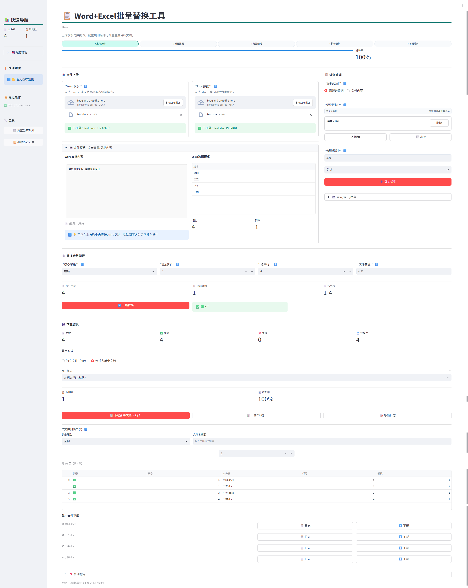

# 文档批量替换助手（WordReplace）

> 用 Word 模板 + Excel 数据，一键批量生成文档。单镜像、单容器，适合个人和小团队自建使用。

把 Word 模板（`.docx`）里的占位符，按 Excel（`.xlsx` / `.xls`）每一行的数据批量替换，生成一批新文档，并支持下载 ZIP、合并后的 Word，或单个文件。适合通知书、合同、证书、函件、名册等标准化文档场景。



当前版本：**v3.0.0**（以根目录 [`VERSION`](VERSION) 为准）

---

## 目录

- [为什么用它](#为什么用它)
- [v3.0 重点更新](#v30-重点更新)
- [30 秒 Docker 部署](#30-秒-docker-部署)
- [Compose 示例](#compose-示例)
- [使用流程（5 步）](#使用流程5-步)
- [环境变量](#环境变量)
- [数据持久化与备份](#数据持久化与备份)
- [升级与回滚](#升级与回滚)
- [安全说明](#安全说明)
- [常见问题](#常见问题)
- [项目结构](#项目结构)
- [开发模式](#开发模式)
- [测试与校验](#测试与校验)
- [版本管理](#版本管理)
- [许可证](#许可证)

---

## 为什么用它

- **批量替换**：把模板中的关键词自动映射到 Excel 列，逐行生成文档。
- **结果清晰**：执行后直接显示总数、成功、失败、替换次数，明细可翻页查看。
- **导出灵活**：支持 ZIP 批量下载、合并为一个 Word，或单独下载某个文件。
- **多工作表支持**：一个 Excel 有多个工作表时，可在预览区切换后再执行。
- **格式友好**：尽量保留原文档的字体、加粗、表格、页眉页脚、图片与编号。
- **部署简单**：前后端打包成一个镜像，一条命令即可启动。
- **默认更安全**：容器以非 root 用户运行，导出下载带签名令牌与有效期。

---

## v3.0 重点更新

| 能力 | 说明 |
|---|---|
| 工作表选择 | Excel 有多个 Sheet 时，页面上可选择要使用的工作表，预览与执行保持一致。 |
| 空值保留占位符 | 勾选“Excel 单元格为空时保留原占位符”后，空单元格不会把模板占位符替换成空白。 |
| 列名校验 | 执行前校验规则列、文件名列是否存在于当前工作表；缺失时直接提示并禁用执行按钮。 |
| 结果分页 | 结果明细按每页 50 条显示，支持上一页 / 下一页；后端另提供分页明细接口。 |
| 导出令牌过期 | 导出链接使用 HMAC 签名并带有效期，过期或篡改会返回明确提示。 |
| 非 root 容器 | 镜像以 UID `10001` 的 `appuser` 运行，入口脚本启动时修正数据目录权限。 |
| docxcompose 合并 | 使用 `docxcompose` 合并文档，图片、页眉、编号等更完整；依赖缺失时自动降级为基础合并。 |

更详细的版本变化见 [CHANGELOG.md](CHANGELOG.md)。

---

## 30 秒 Docker 部署

### 方式一：本地源码构建（最快上手）

在项目根目录执行：

```bash
docker compose up -d --build
```

打开浏览器访问：

```text
http://localhost:12344
```

### 方式二：直接使用已发布镜像

```bash
docker compose -f docker-compose.example.yml pull
docker compose -f docker-compose.example.yml up -d
```

访问：`http://你的服务器IP:12344`

> 首次使用建议先看 [GETTING_STARTED.md](GETTING_STARTED.md)。
> 群晖、反向代理、HTTPS、权限等部署细节见 [docs/DEPLOYMENT.md](docs/DEPLOYMENT.md)。

---

## Compose 示例

单镜像部署，只需要一个服务。下面是最常用的写法（不使用 `version:` 字段，适配 Docker Compose v2）：

```yaml
services:
  wordreplace:
    image: ghcr.io/marod1m/wordreplace:v3.0.0
    container_name: wordreplace
    restart: unless-stopped
    ports:
      - "12344:8000"
    volumes:
      - ./data:/app/data
    environment:
      CORS_ALLOW_ORIGINS: "http://localhost:12344"
      ALLOWED_HOSTS: "*"
      MAX_UPLOAD_SIZE_MB: "50"
      MAX_EXCEL_ROWS: "20000"
      MAX_REPLACE_RULES: "500"
      RUN_CACHE_TTL_SECONDS: "1800"
      RUN_CACHE_MAX_ENTRIES: "200"
      RUN_CACHE_MAX_BYTES: "536870912"
      MAX_CONCURRENT_RUNS: "1"
      EXPORT_TOKEN_SECRET: "请改成足够长的随机字符串"
```

启动：

```bash
docker compose up -d
```

说明：

- `12344:8000` 中，左边的 `12344` 是宿主机端口，可自行修改；右边 `8000` 是容器内端口，不要改。
- `./data:/app/data` 用于持久化 SQLite 数据库（规则模板等）。建议保留。
- 生产环境请务必修改 `EXPORT_TOKEN_SECRET`，并把 `ALLOWED_HOSTS` 改成你的域名。
- 建议固定版本标签（如 `v3.0.0`），不要长期使用 `latest`。

---

## 使用流程（5 步）

1. **上传文件**：选择 Word 模板（`.docx`）和 Excel 数据（`.xlsx` / `.xls`）。
2. **确认预览**：系统自动预览模板文字与 Excel 前 25 行；多工作表时选择需要的工作表。
3. **添加规则**：填写“模板关键字 → Excel 列名”，也可以从模板库加载；支持编辑、删除。
4. **设置参数**：选择起始行、结束行、文件名来源列、序号来源与格式，按需填写前缀 / 后缀。
5. **执行并下载**：点击“开始替换”，查看统计与明细，然后下载 ZIP、合并文档或单个文件。

补充说明：

- 执行使用的是**当前页面上的规则集合**，不会强制套用数据库里的全局规则。
- Excel 单元格为空时，默认替换为空；勾选“保留原占位符”后保留模板原文字。
- 结果默认在内存中保留 30 分钟（`RUN_CACHE_TTL_SECONDS`），过期后需重新执行。
- 页面上传区提供两组内置示例文件，可直接下载体验。

---

## 环境变量

以下变量均通过 Docker Compose 的 `environment` 传入，未填写时使用默认值。

| 变量名 | 默认值 | 说明 |
|---|---|---|
| `APP_VERSION` | `3.0.0` | 应用版本号，镜像构建时自动注入，一般无需手动设置。 |
| `DATABASE_URL` | `sqlite:////app/data/wordreplace.db` | 数据库连接串，默认使用挂载目录下的 SQLite。 |
| `CORS_ALLOW_ORIGINS` | `http://localhost:12344,http://localhost:3000` | 允许跨域调用 API 的前端来源，逗号分隔，必须是完整 Origin（协议 + 域名 + 端口，不带路径）。 |
| `ALLOWED_HOSTS` | `*` | 允许访问的 Host，逗号分隔；公网部署建议改成你的域名。 |
| `MAX_UPLOAD_SIZE_MB` | `50` | 单个上传文件大小上限（MB），超出返回 413。 |
| `MAX_EXCEL_ROWS` | `20000` | Excel 数据行数上限。 |
| `MAX_EXCEL_CELLS` | `200000` | Excel 单元格总数上限（高级项，Compose 未默认列出）。 |
| `MAX_REPLACE_RULES` | `500` | 单次执行规则数量上限。 |
| `MAX_PREVIEW_ROWS` | `25` | 预览显示的 Excel 行数（高级项）。 |
| `MAX_PREVIEW_CHARS` | `20000` | Word 预览文字最大字符数，超出截断（高级项）。 |
| `RUN_CACHE_TTL_SECONDS` | `1800` | 结果缓存有效期（秒），同时决定导出令牌有效期。 |
| `RUN_CACHE_MAX_ENTRIES` | `200` | 结果缓存最大记录数，超出后淘汰最旧记录。 |
| `RUN_CACHE_MAX_BYTES` | `536870912`（512MB） | 结果缓存总字节上限，超出后淘汰最旧记录。 |
| `MAX_CONCURRENT_RUNS` | `1` | 同时执行的任务数；个人使用建议保持 1。 |
| `EXPORT_TOKEN_SECRET` | `change-this-secret`（代码默认） | 导出签名密钥，生产环境必须改成强随机字符串；Compose 示例中的 `please-change-to-a-long-random-secret` 只是占位符。 |

> 结果保存在**进程内存**中，因此请保持单 worker / 单副本运行。多 worker 或多副本需要自行改造为 Redis 等外置缓存。

---

## 数据持久化与备份

默认数据库路径是容器内的 `/app/data/wordreplace.db`。使用 `./data:/app/data` 挂载后：

- 容器重建、升级不会丢失规则模板等数据。
- 生成的替换结果**不会**写入磁盘，只保存在内存中，重启即清空。

备份（推荐先停止服务，保证 SQLite 文件一致）：

```bash
docker compose stop
cp -r ./data "./data.backup-$(date +%Y%m%d-%H%M%S)"
docker compose start
```

恢复：

```bash
docker compose stop
cp -r ./data.backup-你的时间戳/. ./data/
docker compose start
```

也可以使用项目自带脚本：

```bash
./scripts/backup.sh
./scripts/restore.sh ./backups/wordreplace-data-你的时间戳.tar.gz
```

更多备份、恢复、权限和反向代理说明见 [docs/DEPLOYMENT.md](docs/DEPLOYMENT.md)。

---

## 升级与回滚

升级前先备份 `./data`，然后执行：

```bash
docker compose pull
docker compose up -d
```

固定版本升级或回滚：

1. 修改 compose 中的镜像标签（例如 `v3.0.0`）。
2. 执行：

```bash
docker compose pull
docker compose up -d
```

验证：

```bash
curl -fsS http://localhost:12344/health
curl -fsS http://localhost:12344/health/ready
```

页面底部会显示当前版本号。完整步骤见 [docs/UPGRADE.md](docs/UPGRADE.md)。

> 容器以非 root 用户（UID `10001`）运行。若挂载目录权限不正确，可执行 `sudo chown -R 10001:10001 ./data`。

---

## 安全说明

- **必须修改默认密钥**：`EXPORT_TOKEN_SECRET` 的代码默认值是 `change-this-secret`，公开部署前务必替换为足够长的随机字符串。
- **限制访问域名**：公网部署时把 `ALLOWED_HOSTS` 设置为你的真实域名，而不是 `*`。
- **使用 HTTPS**：建议通过 Caddy、Nginx 或群晖反向代理提供 HTTPS。
- **不要裸奔**：本项目默认没有账号密码体系。若需公网访问，建议在反向代理层增加访问认证（Basic Auth、Authelia、Authentik 等），或只在内网使用。
- **上传限制**：默认单文件 50MB，反向代理也需要同步放宽请求体大小。
- **结果会过期**：内存结果和导出令牌默认 30 分钟后失效，过期后重新执行即可。
- **安全响应头**：应用会返回 `X-Content-Type-Options`、`X-Frame-Options` 等基础安全头。

详见 [SECURITY.md](SECURITY.md)。

---

## 常见问题

| 现象 | 先看这里 |
|---|---|
| 上传返回 413 | 调大 `MAX_UPLOAD_SIZE_MB`，并同步调大反向代理的请求体上限。 |
| 提示“文件内容与扩展名不匹配” | 文件可能只是改了后缀，请用 Office/WPS 重新另存为正确格式。 |
| 提示 Excel 列不存在 | 列名必须与表头完全一致（含空格），并确认当前选择的工作表正确。 |
| 执行后结果 0 条 | 检查起始行 / 结束行、工作表，以及 Excel 是否只有表头。 |
| 下载提示结果已过期 | 重新执行一次；或适当调大 `RUN_CACHE_TTL_SECONDS`。 |
| `./data` 权限错误 | `sudo chown -R 10001:10001 ./data`。 |
| 端口被占用 | 修改 compose 左侧端口，或停止占用该端口的程序。 |
| 容器 unhealthy | 查看 `docker compose logs`，确认数据库目录可写。 |

完整排查表见 [docs/TROUBLESHOOTING.md](docs/TROUBLESHOOTING.md)。

---

## 项目结构

```text
WordReplace/
├── backend/
│   ├── app/
│   │   ├── api/          # 路由：health、config、preview、replace、export、rules、templates
│   │   ├── core/         # 配置、上传校验、Excel 读取
│   │   ├── db/           # SQLite 连接与建表
│   │   ├── models/       # 规则、规则模板模型
│   │   ├── schemas/      # 请求 / 响应模型
│   │   └── services/     # 替换引擎、模板库、规则服务
│   ├── tests/            # pytest 测试
│   └── requirements*.txt
├── frontend/
│   ├── src/app/          # Next.js 页面
│   ├── src/components/   # 上传、规则、执行、结果等组件
│   ├── src/hooks/        # 预览、配置、显示设置
│   └── src/lib/          # API 客户端与常量
├── docs/                 # 部署、排障、架构、API、升级文档
├── scripts/sync_version.py
├── Dockerfile            # 前后端单镜像构建
├── entrypoint.sh         # 非 root 启动与数据目录授权
├── docker-compose.yml
├── docker-compose.example.yml
├── VERSION
└── LICENSE
```

更多设计说明见 [docs/ARCHITECTURE.md](docs/ARCHITECTURE.md)，接口说明见 [docs/API.md](docs/API.md)。

---

## 开发模式

### 后端

```bash
cd backend
python3 -m venv .venv
source .venv/bin/activate
pip install -r requirements.txt
uvicorn app.main:app --reload --port 8000
```

后端默认监听 `http://localhost:8000`，健康检查为 `/health`。

### 前端

```bash
cd frontend
cp .env.local.example .env.local
pnpm install --ignore-scripts
pnpm dev
```

前端默认监听 `http://localhost:3000`，开发时可把 `NEXT_PUBLIC_API_BASE` 指向 `http://localhost:8000`。

### 本地联调注意

- 后端 `CORS_ALLOW_ORIGINS` 默认包含 `http://localhost:3000`。
- 开发模式建议在启动前设置 `DATABASE_URL=sqlite:///./wordreplace.db`，否则会使用容器路径 `/app/data/wordreplace.db`。
- 生成结果仍在内存中，后端重启即清空。

开发约定与提交检查见 [CONTRIBUTING.md](CONTRIBUTING.md)。

---

## 测试与校验

后端：

```bash
cd backend
pip install -r requirements-dev.txt
python -m pytest -q
```

前端：

```bash
cd frontend
pnpm install --frozen-lockfile --ignore-scripts
pnpm lint
pnpm build
```

版本一致性：

```bash
python3 scripts/sync_version.py --check
```

一键检查（存在依赖时自动执行后端测试与前端 lint/build）：

```bash
bash scripts/check_all.sh
```

CI 会自动执行版本校验、后端测试、前端 lint 与 build，并构建多架构镜像。

---

## 版本管理

项目以根目录 [`VERSION`](VERSION) 作为单一版本源，前端显示、后端配置和镜像构建都会读取它。

修改版本号：

1. 编辑 `VERSION`。
2. 运行同步脚本：

```bash
python3 scripts/sync_version.py
```

3. 校验是否一致：

```bash
python3 scripts/sync_version.py --check
```

---

## 相关文档

- [快速开始](GETTING_STARTED.md)
- [部署指南](docs/DEPLOYMENT.md)
- [故障排查](docs/TROUBLESHOOTING.md)
- [架构说明](docs/ARCHITECTURE.md)
- [API 参考](docs/API.md)
- [升级与回滚](docs/UPGRADE.md)
- [安全说明](SECURITY.md)
- [贡献指南](CONTRIBUTING.md)
- [验收清单](ACCEPTANCE_CHECKLIST.md)
- [更新日志](CHANGELOG.md)

---

## 许可证

本项目使用 MIT License，详见 [LICENSE](LICENSE)。
